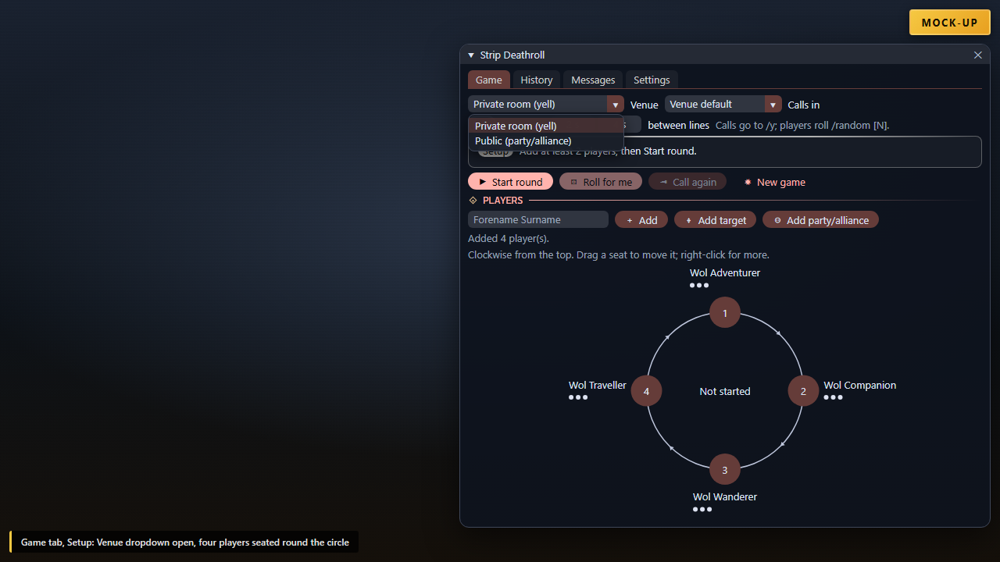
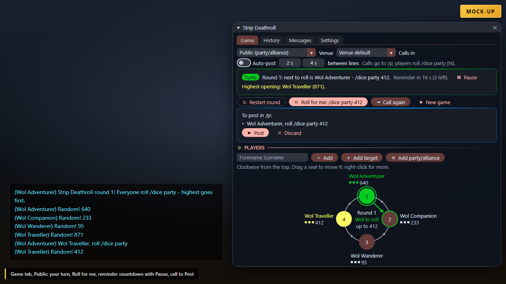
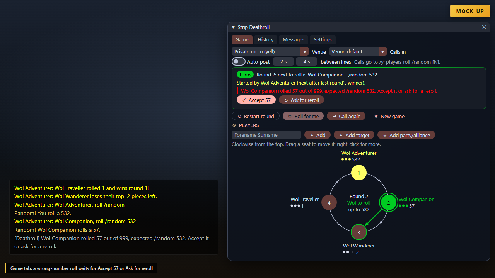
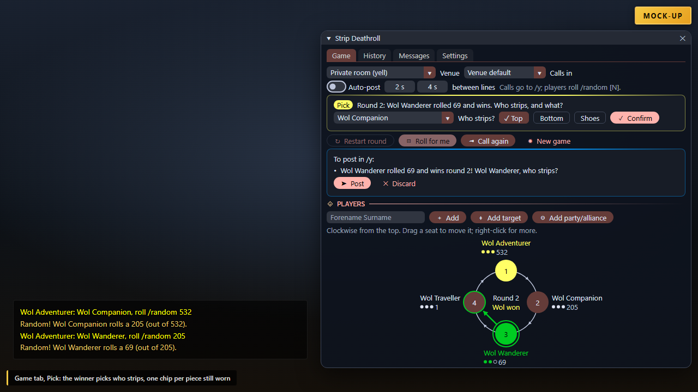
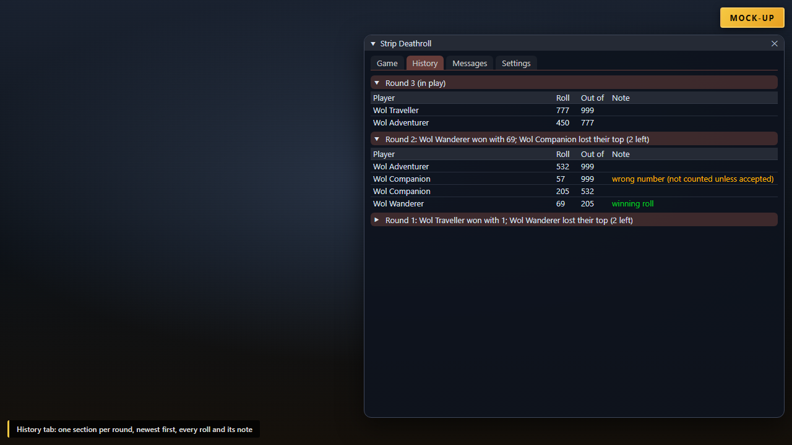
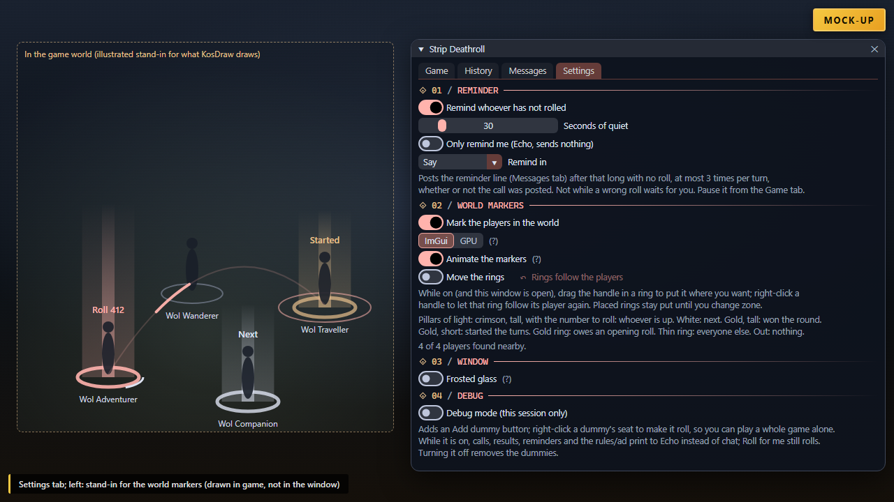

# StripDeathroll14


A host helper for Strip Deathroll at FFXIV venues: it keeps the turn order, calls each player to roll, catches wrong rolls, and tracks pieces and round history.

`/sdr` · Dalamud API 15 · .NET 10

> **No support will be provided. This software is to be used as is, without warranty of any kind.**

## Screenshots

These images are **mock-ups** (HTML rendered to PNG). They are not real in-game captures and do not show the actual FFXIV client UI.

| | |
| --- | --- |
|  | **Setup** — Game tab with the Venue dropdown open (*Private room (yell)* / *Public (party/alliance)*) and four players seated round the circle, *Start round* ready. |
|  | **Your turn** — Public venue: the highest opening `/dice party` roll started, *Roll for me* shows `/dice party 412`, the reminder counts down with *Pause* next to it, and the call waits for *Post*. |
|  | **Wrong roll** — a bare `/random` when `/random 532` was due: a red callout in the window, a `[Deathroll]` line in Echo, and *Accept 57* / *Ask for reroll*. |
|  | **Who strips?** — a 69 wins the round; the winner picks a player (themselves included) and one chip per piece still worn, then *Confirm*. |
|  | **History** — one section per round, newest first: winner, winning roll, who lost what; inside, every roll with its range and note. |
|  | **Messages** — the rules and ad texts posted line by line to Say, and the game lines in your own words, each with a filled-in example and *Default*. |
|  | **Settings** — Reminder, World markers, Window (frosted glass) and Debug; beside it an illustrated stand-in for the rings and pillars of light KosDraw draws in the game world. |

## Mock-up video

A short **mock-up** walkthrough (not real gameplay) cross-fades through setup, your turn, a wrong-roll alert, *Who strips?*, the Settings tab with a world-marker stand-in and the Messages tab, with bottom captions. The gold **Mock-up** label stays visible for the whole clip.

- [mockup-walkthrough.mp4](docs/videos/mockup-walkthrough.mp4) (H.264, 1280×720, ~15 s)
- [mockup-walkthrough.gif](docs/videos/mockup-walkthrough.gif) (preview)

## What it does

- **Private or Public** — a dropdown. Private room: calls go to `/y` and players roll `/random N`. Public: calls go to `/p` (or `/a` when you are in an alliance) and players roll `/dice party N` / `/dice alliance N`, so the rolls stay in the group. Rolls are read in every form either way.
- **Calls in** — where your calls and results go: *Venue default* (as above), Say, Yell or Party.
- **Player list** — add everyone in your party or alliance (cross-world parties included) with one button, add the player you have targeted with *Add target*, or type names in as `Forename Surname`. Their order *is* the turn order and the plugin never reorders it. *Clear players* (Ctrl+click) empties the list; a round in play stops.
- **Circle** — the Game tab seats the players round a circle, in turn order clockwise from the top: the player to roll is green with a pulsing ring, a green arrow points to whoever is up after them, the opener/starter is yellow, out players are dimmed, and each seat shows the pieces still worn as dots and the last roll. Drag a seat onto another to move that player there (the others shift round); right-click a seat to move it one place, remove it (hold Ctrl) or, in debug mode, roll for a dummy.
- **Opening roll (round 1)** — *Start round* proposes "everyone roll /random". When every active player has rolled, the highest is highlighted in yellow and goes first with a fresh `/random`; the turn then goes clockwise from them. The player next to roll is highlighted in green. Each seat shows the player's most recent roll in any round (hover the seat for the round and note). A tie for first goes to whoever sits first counting clockwise from the top and is flagged, so you can restart the round for a roll-off.
- **Turn calls** — it proposes `Name, roll /random` for the starter, then `Name, roll /random N`, where N is the previous player's roll, round the circle.
- **Alerts** — a roll with the wrong number (`out of 999` when 532 was expected), a roll out of turn, a second opening roll, or a non-bare opening roll prints a `[Deathroll]` line in Echo and shows in red in the window. A wrong-number roll waits for you: *Accept* it or *Ask for reroll*.
- **Round end** — a 0, 1, 69 or 666 wins the round (`/random` rolls from 0). The window asks *Who strips?* from the active players, the winner included, and which piece comes off: top, bottom or shoes, from what they still wear. At no pieces they are out. The next round has no opening roll: it resumes with the next active player clockwise from the winner, who rolls a fresh `/random` and is called at once (shown as *started*). *Restart round* restarts the round in play with an opening roll under the same round number, dropping its rolls. One player left is game over.
- **History** — one section per game (*Game 1*, *Game 2*, …; the game in play open, earlier ones closed with their round count and top winner), and inside it one section per round, newest first, headed by the winner, winning roll, who stripped, which piece and what is left; inside, every roll of that round with who rolled, the number, the range and what became of it (opening, counted, out of turn, wrong number, accepted, winning roll). Wins per player are in each seat's tooltip. *Export CSV* saves every game to a file you choose (one line per roll, plus each round's result: game, round, player, roll, out of, note, who stripped, piece, pieces left). *Clear history* (Ctrl+click) deletes the past games, and this game's rounds too unless a round is in play; numbering then starts again at Game 1.
- **Fixing rolls** — once a round has started (*Edit rolls* on the Game tab opens it), the History tab lets you change a roll of the round in play (number and range), delete one (Ctrl+click), or add a roll the plugin missed for any active player. After a change the round is worked out again from its start over its rolls in order, your accepts included, so the turn, the number to roll and a win follow the fix; a roll that no longer counts (after the win) stays listed so a second fix can bring it back. If the turn moved, the new call or win line is proposed. Earlier rounds cannot be changed.
- **New game** — Ctrl+click for a clean slate: everyone back to 3 pieces, round 1 again, alerts and unposted lines cleared. The game so far moves to the History tab as *Game N*. The players stay.
- **Reminder** — off by default. When on, after a set quiet time (15–120 s, default 30) it posts `Reminder: Name, it's your turn - roll /random N` in Say or Party, or names everyone still missing an opening roll; at most 3 times per wait (the Game tab counts down the seconds to the next one and how many are left), whether or not the call itself was posted, at any point in the game. Not while a wrong roll is waiting for you. **Pause** next to the countdown holds the timer, through turn changes too, until you press *Resume* (this session only). **Only remind me** prints the reminder to your own Echo and sends nothing.
- **Debug mode** — for trying it out alone in game. *Add dummy* adds stand-in players (Dummy Alpha to Dummy Xray, up to 24); right-click a dummy's seat for *Roll for this dummy* or *Make this dummy roll a 1*, which roll for it through the same path as a chat roll. While it is on, every call, result, reminder and rules/ad line prints to Echo instead of chat; *Roll for me* still really rolls. It lasts for the session, and turning it off removes the dummies.
- **Messages** — the rules and ad, two saved texts (*Default* restores the shipped wording) posted one chat line per text line (up to 10) to Say, Yell or Party; and the wording of every game line the plugin posts (round start, call, win, strip, out, game over and both reminders). Words in `{braces}` such as `{name}` and `{roll}` are filled in, each line shows a filled-in example (red if it could not be sent), and a blank line uses the default.
- **Roll for me** — when it is your roll, one press (or `/sdr roll` from a hotbar macro) sends the right command: a fresh `/random` for the opening roll or when you start the turns, otherwise `/random N` to the previous roll (`/dice party|alliance` in Public). The button shows the command it will send; a second press for the same turn within 10 s is ignored, so a double press never rolls twice.

### What it is not meant to do

- **It does not roll for anyone but you,** and it rolls for you only when you press *Roll for me* or run `/sdr roll`.
- **It does not post on its own unless you turn on Auto-post.** By default every call and result waits in the window for *Post*. A newer call replaces one you have not posted, but the lines of one event stay together: after a pick, the win (if not posted yet, without its "who strips?"), who lost what, and the next call or game-over line wait as one batch.
- **It does not choose who strips or what comes off.** That is the winner's call; you pick both in the window.
- **It does not handle bets or gil.**

## How it works

Rolls are read from chat (`IChatGui.ChatMessage`, nothing is hidden): `RandomNumber` lines in the form `Random! Name rolls a N (out of M).` and `/dice` lines `Random! (1-M) N` in Party, Cross-world Party and Alliance, with the roller taken from the player link in the message. The formats are the ones ChatDeathRoll2 and FFXIVGamblePyon both parse. A roll only counts for someone on the list, so spectators rolling nearby change nothing.

Everything posted goes through one queue, sent with `UIModule.ProcessChatBoxEntry` (no hooks, no signatures of its own), one at a time, a random 2 to 5 s apart: you set the lower and upper limit with *between lines* next to Auto-post (default 2-4 s), and each gap is picked at random between them, to the millisecond. Only while logged in. Roll commands, calls, reminders and rules/ad lines all share it, so they can never be sent closer together; at most 12 lines can wait, and a line that is already waiting is not queued again. Every posted line is checked to be one line, under 400 bytes and not a command, and, since you can word every one of them, run through the game's own text sanitiser and dropped, never altered, if it would change it. Player names are validated before they are used in a line.

## Commands

| Command | Effect |
| --- | --- |
| `/sdr` | Open or close the window. |
| `/sdr roll` | Make your correct roll now (same as *Roll for me*); otherwise a `[Deathroll] It is not your roll.` alert in Echo and the window. |

## Settings

- **Venue** — Private room (yell) or Public (party/alliance).
- **Calls in** — Venue default, Say, Yell or Party.
- **Auto-post** — off by default; on posts calls and results as they happen.
- **Messages** — the rules and ad texts and the channel they go to (Say, Yell, Party), and the game lines' wording.
- **Reminder** (Settings tab) — on/off (off by default), seconds of quiet (15–120), Say or Party, or only to your own Echo.
- **Look** — the window uses MaterialKos (Material 3 colours) in the KosMos palette: night-blue surfaces with crimson and gold, and rounder windows and frames. It follows your Dalamud theme's light or dark choice and keeps its background transparency. **Frosted glass** (Settings → Window, off by default) blurs whatever is behind the window, the game and other windows, tinted night blue, using Dalamud's own blur; the window turns slightly see-through for it (at most 85% opaque) and gets no blur while dragged out of the game window. There is no other style setting while this look is being tested.
- **World markers** (Settings tab, on by default) — rings under the listed players in the game world, drawn by [KosDraw](https://github.com/priestkos/KosDraw) in the same KosMos colours. A pillar of light rises from the ring of whoever is up (crimson, tall, with the number to roll), who is next (white), who started the turns (gold, short) and the round winner (gold, tall). A gold ring marks an owed opening roll, a thin ring everyone else, nothing once out. Players never stand in a perfect circle, so **Move the rings** puts a handle in each ring while the window is open: drag it to place the ring on the ground under the mouse, right-click to let it follow its player again (*Rings follow the players* resets them all; changing zone or logging out does too). A placed ring shows even when its player is away. **Animate the markers** (on by default) adds motion that says what just happened: a light circling the ring of whoever is up, a ripple from each roll (gold for a winning roll, grey for one that did not count) and a light running along an arch from the roller to the next player. Off, the marks stand still; they also stand still while Dalamud's **Reduce motion** setting is on. **ImGui** draws over everything; **GPU** uses KosDraw's Direct3D path, so rings fade behind scenery and stay off the game's UI, and any part that fails switches itself off and falls back to ImGui. In debug mode the dummy players stand in a ring round you.
- **Debug mode** (Settings tab) — session only, never saved. While it is on, the Settings tab also shows the KosLib gallery (every component in every preset).

## Build

Requires the .NET 10 SDK and the Dalamud dev distribution
(`%APPDATA%\XIVLauncher\addon\Hooks\dev`, or `DALAMUD_HOME`). The shared UI pieces come from the
[KosLib](https://github.com/priestkos/KosLib) submodule and the world markers from the
[KosDraw](https://github.com/priestkos/KosDraw) submodule, so clone with `git clone --recurse-submodules`
(or run `git submodule update --init` in an existing clone). Each hour the Library pins workflow moves both pins to
their library's latest `main` once the build and tests pass, or opens an issue if they don't.

```
dotnet build -c Debug      # load bin/Debug/StripDeathroll14.dll as a dev plugin
dotnet build -c Release    # zip in bin/Release/StripDeathroll14/latest.zip
```

## Install

Add `https://raw.githubusercontent.com/priestkos/PlogonYes/main/pluginmaster.json` under `/xlsettings` → Experimental → Custom Plugin Repositories, then install **StripDeathroll14** from `/xlplugins`.

## Install (dev plugin)

1. `/xlsettings` → Experimental → Dev Plugin Locations → add `bin\Debug\StripDeathroll14.dll`.
2. `/xlplugins` → Dev Tools → enable **StripDeathroll14**.
3. `/sdr` opens the window.

## Tests

`StripDeathroll14.Tests` (xUnit) compiles `Game.cs` with no Dalamud and covers the roll parsers, name matching (party-slot and cross-world glyphs), name validation, the highest opening roll starting without reordering the list, later rounds resuming after the winner (out players skipped), ties, the starter's fresh `/random`, wrong-number and out-of-turn rolls, the 0/1/69/666 endings, picking a piece (and the winner picking themselves), three pieces to out and game over, the per-round roll log and its notes, dummy players, the reminder's waiting list and clock (interval, reset on progress, cap of 3, pause and resume), removing and moving players mid-round, the posted lines and commands (and the host's own wording for them), the world markers' roles and motion cues (new rolls and the turn's hand-over, each reported once), restarting a round under the same number, editing, deleting and replaying a round's rolls (accepts kept, rolls after a win kept as void), clearing the players, games kept by New game and clearing them, the CSV export (quoting and spreadsheet-formula guard), pinned enum numbers, and a 2,000-game random-play sweep that asserts every game finishes.

```
dotnet test StripDeathroll14.Tests    # 58 tests
```

## Limits

- **Not verified in game.** This description comes from the code and the offline tests, not from a live client.
- **English client only.** The roll regexes match the English messages, so on JP, DE or FR clients no roll is recognised and the game never moves on; nothing is posted wrongly.
- **Not verified in game:** the chat type a `/dice alliance` line arrives with, and alliance detection in a live alliance. Both come from reading Dalamud and other plugins' code. If either is wrong, those rolls are not read and the turn waits.
- **`/random` is visible to nearby players** in the /say radius. That is how the game works; Public mode asks for `/dice` so rolls stay in the group.
- **A `/dice` roll can be faked.** `/dice` lines are read from Party, Cross-world Party and Alliance chat (in both venue modes), and the plugin does not tell a real one from a player on the list typing `Random! (1-N) 1` there by hand on their turn. When a roll decides the round, check it in chat before you carry on.
- **Only round 1 has an opening roll.** From round 2 the turn resumes with the player after the last winner; press *Start round* for an opening roll instead.
- **Session only.** Players and every game in the history are cleared by a plugin reload (export the CSV first to keep them); settings and the rules and ad texts are saved.
- **Add target needs a player targeted**, and only adds them; it reads the game's current target, nothing else.
- **Echo alerts need the Echo chat filter ticked** in your chat log tab; the alert also shows in the window.
- **The text check on every posted line uses the game's sanitiser with a guessed flag set** (letters, numbers, symbols, CJK). A line it would change is dropped with an alert, never sent altered.

## Layout

```
Game.cs            pure rules: players, opening, turns, endings, piece picks, history and roll log, reminder clock, parsers, lines
Plugin.cs          chat reading, the send queue, party and target import, alerts, reminders, debug rolls
MainWindow.cs      Game / History / Messages / Settings tabs
MainWindow.Circle.cs   the players' circle on the Game tab (seats, turn arrow, drag to reseat, seat menu)
MainWindow.Style.cs    phase label and colour for the status card
WorldMarkers.cs    the KosDraw rings, pillars of light and motion under the players
Configuration.cs   saved settings and texts
KosLib/            submodule: shared cards, section headers, toggles and presets (github.com/priestkos/KosLib), compiled in from KosLib/src
KosDraw/           submodule: world-space drawing, ImGui or Direct3D (github.com/priestkos/KosDraw)
StripDeathroll14.Tests/   xUnit tests over Game.cs
docs/              mock-up screenshots and walkthrough video
images/            icon.svg (source) and icon.png (manifest icon)
.github/workflows/ build.yml (build + tests on every push), release.yml (tests, build, release on main)
```
