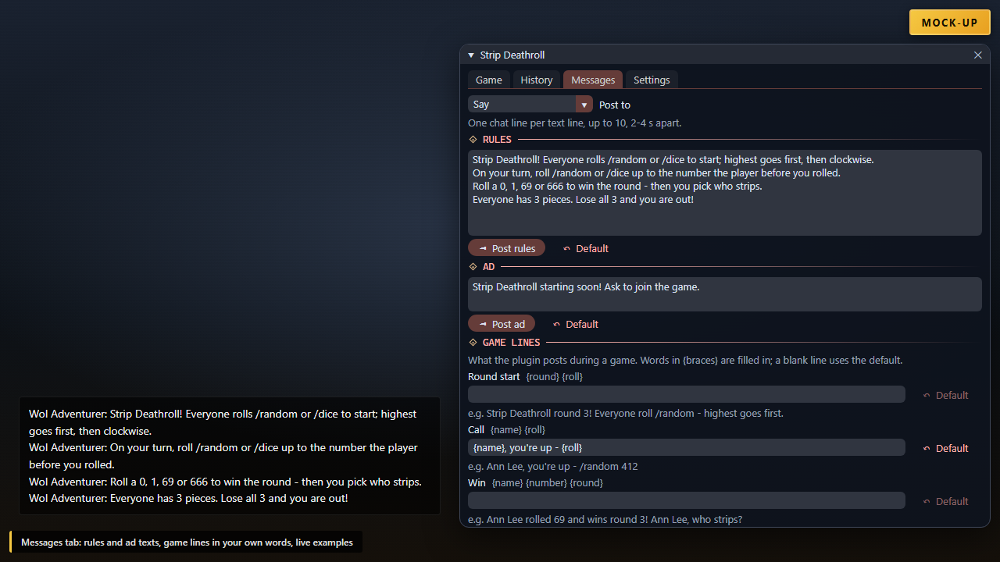

# StripDeathroll14


A host helper for Strip Deathroll at FFXIV venues: it keeps the turn order, calls each player to roll, catches wrong rolls, and tracks pieces and round history.

`/sdr` · Dalamud API 15 · .NET 10

> **No support will be provided. This software is to be used as is, without warranty of any kind.**

## Screenshots

These images are **mock-ups** (HTML rendered to PNG). They are not real in-game captures and do not show the actual FFXIV client UI.

| | |
| --- | --- |
|  | **Setup** — Game tab with the Venue dropdown open (Private room / Public) and four players added with *Add party/alliance*. |
|  | **Your turn** — Public venue: the opening `/dice party` rolls set the order high to low, *Roll for me* shows `/dice party 412`, and the next call waits for *Post*. |
|  | **Wrong roll** — a bare `/random` when `/random 532` was due: a red alert in the window, a `[Deathroll]` line in Echo, and *Accept 57* / *Ask for reroll*. |
|  | **Who strips?** — a 69 wins the round; the winner picks from the other active players. |
|  | **History** — four rounds, newest first: winner, winning roll (1, 69, 666), who stripped and pieces left, down to out. |
|  | **Rules & Ad** — the default texts, posted one chat line per text line to Say. |

## Mock-up video

A short **mock-up** walkthrough (not real gameplay) cross-fades through setup, your turn, a wrong-roll alert, *Who strips?* and the Rules & Ad tab with bottom captions. The gold **Mock-up** label stays visible for the whole clip.

- [mockup-walkthrough.mp4](docs/videos/mockup-walkthrough.mp4) (H.264, 1280×720, ~15 s)
- [mockup-walkthrough.gif](docs/videos/mockup-walkthrough.gif) (preview)

## What it does

- **Private or Public** — a dropdown. Private room: calls go to `/s` and players roll `/random N`. Public: calls go to `/p` (or `/a` when you are in an alliance) and players roll `/dice party N` / `/dice alliance N`, so the rolls stay in the group. Rolls are read in every form either way.
- **Calls in** — where your calls and results go: *Venue default* (as above), Say, Yell or Party.
- **Player list** — add everyone in your party or alliance (cross-world parties included) with one button, add the player you have targeted with *Add target*, or type names in as `Forename Surname`. Remove (Ctrl+click) and move players up or down; the list *is* the turn order and the plugin never reorders it.
- **Opening roll (round 1)** — *Start round* proposes "everyone roll /random". When every active player has rolled, the highest is highlighted in yellow and goes first with a fresh `/random`; the turn then goes down the list from them and wraps round. The player next to roll is highlighted in green. The *Last roll* column shows each player's most recent roll in any round (greyed if it was not counted; hover for the round and note). A tie for first goes to whoever is higher in the list and is flagged, so you can restart the round for a roll-off.
- **Turn calls** — it proposes `Name, roll /random` for the starter, then `Name, roll /random N`, where N is the previous player's roll, looping the list.
- **Alerts** — a roll with the wrong number (`out of 999` when 532 was expected), a roll out of turn, a second opening roll, or a non-bare opening roll prints a `[Deathroll]` line in Echo and shows in red in the window. A wrong-number roll waits for you: *Accept* it or *Ask for reroll*.
- **Round end** — a 0, 1, 69 or 666 wins the round (`/random` rolls from 0). The window asks *Who strips?* from the active players, the winner included, and which piece comes off: top, bottom or shoes, from what they still wear. At no pieces they are out. The next round has no opening roll: it resumes with the next active player in the list after the winner, who rolls a fresh `/random` and is called at once (shown as *started*). *Start round* still restarts a round with an opening roll. One player left is game over.
- **History** — one section per round, newest first, headed by the winner, winning roll, who stripped, which piece and what is left; inside, every roll of that round with who rolled, the number, the range and what became of it (opening, counted, out of turn, wrong number, accepted, winning roll). Wins per player are in the list.
- **Reminder** — off by default. When on, after a set quiet time (15–120 s, default 30) it posts `Reminder: Name, it's your turn - roll /random N` in Say or Party, or names everyone still missing an opening roll; at most 3 times per wait (the Game tab counts down the seconds to the next one and how many are left), whether or not the call itself was posted, at any point in the game. Not while a wrong roll is waiting for you.
- **Debug mode** — for trying it out alone in game. *Add dummy* adds stand-in players (Dummy Alpha to Dummy Hotel) with *Roll* and *1* buttons on their rows that roll for them through the same path as a chat roll. While it is on, every call, result, reminder and rules/ad line prints to Echo instead of chat; *Roll for me* still really rolls. It lasts for the session, and turning it off removes the dummies.
- **Rules & Ad** — two saved texts (*Default* restores the shipped wording), posted one chat line per text line (up to 10) to Say, Yell or Party.
- **Roll for me** — when it is your roll, one press (or `/sdr roll` from a hotbar macro) sends the right command: a fresh `/random` for the opening roll or when you start the turns, otherwise `/random N` to the previous roll (`/dice party|alliance` in Public). The button shows the command it will send; a second press for the same turn within 10 s is ignored, so a double press never rolls twice.

### What it is not meant to do

- **It does not roll for anyone but you,** and it rolls for you only when you press *Roll for me* or run `/sdr roll`.
- **It does not post on its own unless you turn on Auto-post.** By default every call and result waits in the window for *Post*. A newer call replaces one you have not posted, but the lines of one event stay together: after a pick, the win (if not posted yet), who lost what, and the next call or game-over line wait as one batch.
- **It does not choose who strips or what comes off.** That is the winner's call; you pick both in the window.
- **It does not handle bets or gil.**

## How it works

Rolls are read from chat (`IChatGui.ChatMessage`, nothing is hidden): `RandomNumber` lines in the form `Random! Name rolls a N (out of M).` and `/dice` lines `Random! (1-M) N` in whichever channel `/dice` was sent to (Say, Yell, Shout, Party, Cross-world Party, Alliance, Free Company, PvP Team, Linkshells 1–8, Cross-world Linkshells 1–8), with the roller taken from the player link in the message or the line's sender. The formats are the ones ChatDeathRoll2 and FFXIVGamblePyon both parse. A roll only counts for someone on the list, so spectators rolling nearby change nothing.

Everything posted goes through one queue, sent with `UIModule.ProcessChatBoxEntry` (no hooks, no signatures of its own), one at a time, 1 to 3 s apart (random), only while logged in. Roll commands, calls, reminders and rules/ad lines all share it, so they can never be sent closer together; at most 12 lines can wait, and a line that is already waiting is not queued again. Lines the plugin writes are checked to be one line, under 400 bytes and not a command; rules and ad lines are also run through the game's own text sanitiser and dropped, never altered, if it would change them. Player names are validated before they are used in a line.

## Commands

| Command | Effect |
| --- | --- |
| `/sdr` | Open or close the window. |
| `/sdr roll` | Make your correct roll now (same as *Roll for me*); prints "It is not your roll." otherwise. |

## Settings

- **Venue** — Private room (say) or Public (party/alliance).
- **Calls in** — Venue default, Say, Yell or Party.
- **Auto-post** — off by default; on posts calls and results as they happen.
- **Rules & Ad** — the two texts and the channel they go to (Say, Yell, Party).
- **Reminder** (Settings tab) — on/off (off by default), seconds of quiet (15–120), Say or Party.
- **Debug mode** (Settings tab) — session only, never saved.

## Build

Requires the .NET 10 SDK and the Dalamud dev distribution
(`%APPDATA%\XIVLauncher\addon\Hooks\dev`, or `DALAMUD_HOME`).

```
dotnet build -c Debug      # load bin/Debug/StripDeathroll14.dll as a dev plugin
dotnet build -c Release    # zip in bin/Release/StripDeathroll14/latest.zip
```

## Install

Add `https://raw.githubusercontent.com/priestkos/PlogonYes/main/pluginmaster.json` under `/xlsettings` → Experimental → Custom Plugin Repositories, then install **StripDeathroll14** from `/xlplugins`.

## Install (dev plugin)

1. `/xlsettings` → Experimental → Dev Plugin Locations → add `bin\Debug\StripDeathroll14.dll`.
2. `/xlplugins` → Dev Tools → enable **StripDeathroll14**.
3. `/sdr` opens the window.

## Tests

`StripDeathroll14.Tests` (xUnit) compiles `Game.cs` with no Dalamud and covers the roll parsers, name matching (party-slot and cross-world glyphs), name validation, the highest opening roll starting without reordering the list, later rounds resuming after the winner (out players skipped), ties, the starter's fresh `/random`, wrong-number and out-of-turn rolls, the 0/1/69/666 endings, picking a piece (and the winner picking themselves), three pieces to out and game over, the per-round roll log and its notes, dummy players, the reminder's waiting list and clock (interval, reset on progress, cap of 3), removing and moving players mid-round, the posted lines and commands, pinned enum numbers, and a 2,000-game random-play sweep that asserts every game finishes.

```
dotnet test StripDeathroll14.Tests    # 36 tests
```

## Limits

- **Not verified in game.** This description comes from the code and the offline tests, not from a live client.
- **English client only.** The roll regexes match the English messages, so on JP, DE or FR clients no roll is recognised and the game never moves on; nothing is posted wrongly.
- **Not verified in game:** the chat type a `/dice alliance` line arrives with, and alliance detection in a live alliance. Both come from reading Dalamud and other plugins' code. If either is wrong, those rolls are not read and the turn waits.
- **`/random` is visible to nearby players** in the /say radius. That is how the game works; Public mode asks for `/dice` so rolls stay in the group.
- **A `/dice` roll can be faked.** `/dice` lines are read from Party, Cross-world Party and Alliance chat (in both venue modes), and the plugin does not tell a real one from a player on the list typing `Random! (1-N) 1` there by hand on their turn. When a roll decides the round, check it in chat before you carry on.
- **Only round 1 has an opening roll.** From round 2 the turn resumes with the player after the last winner; press *Start round* for an opening roll instead.
- **Session only.** Players, history and the roll log are cleared by a plugin reload; settings and the rules and ad texts are saved.
- **Add target needs a player targeted**, and only adds them; it reads the game's current target, nothing else.
- **Echo alerts need the Echo chat filter ticked** in your chat log tab; the alert also shows in the window.
- **The text check on rules and ad lines uses the game's sanitiser with a guessed flag set** (letters, numbers, symbols, CJK). A line it would change is dropped with an alert, never sent altered.

## Layout

```
Game.cs            pure rules: players, opening, turns, endings, piece picks, history and roll log, reminder clock, parsers, lines
Plugin.cs          chat reading, the send queue, party and target import, alerts, reminders, debug rolls
MainWindow.cs      Game / History / Rules & Ad / Settings tabs
Configuration.cs   saved settings and texts
StripDeathroll14.Tests/   xUnit tests over Game.cs
docs/              mock-up screenshots and walkthrough video
images/            icon.svg (source) and icon.png (manifest icon)
.github/workflows/ build.yml (build + tests on every push), release.yml (tests, build, release on main)
```
